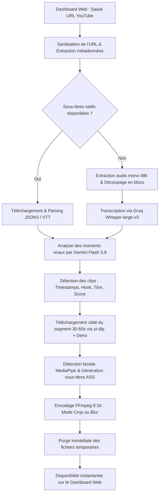

# 🎬 YouTube Shorts Viral Clipper

Système complet d'analyse, d'extraction et de génération de **YouTube Shorts viraux 9:16** à partir de vidéos longues (podcasts, rediffusions de streams, divertissement), optimisé pour tourner sur une infrastructure légère et peu coûteuse (VPS OVH / CloudPanel) sans Docker.

🔗 **Production en ligne :** [ytshorts.victor-giroud.fr](https://ytshorts.victor-giroud.fr)

---

## 📌 1. Fonctionnalités Principales

* 🧠 **Détection IA des moments viraux (Google Gemini 3.8 / 1.5 Flash)** :
  * Analyse de la transcription complète de la vidéo (jusqu'à plusieurs heures).
  * Identification d'accroches percutantes (*hooks*), storytelling et scoring de viralité (0-100).
  * Rédaction automatique de titres accrocheurs, captions et hashtags optimisés.
* ⚡ **Transcription ultra-rapide (Subtitles natifs ou Groq Whisper-large-v3)** :
  * Extraction instantanée des sous-titres YouTube officiels ou automatiques sans réencodage.
  * Repli automatique sur Whisper via l'API Groq (mono 48k en morceaux légers) si aucun sous-titre n'existe.
* 🎥 **Cadrage intelligent vertical 9:16 (1080x1920)** :
  * **Mode Recadrage intelligent (*Crop*)** : Face-tracking dynamique par vision par ordinateur (**MediaPipe**) pour centrer en continu la caméra sur l'orateur, même s'il se déplace.
  * **Mode Fond flouté (*Blur*)** : Vidéo 16:9 au centre avec arrière-plan 9:16 flouté et agrandi.
* ✍️ **Sous-titres animés percutants (Format ASS)** :
  * Typographie moderne avec surlignage dynamique mot à mot (style TikTok / Shorts / Reels).
* 🛡️ **Bypass Anti-Bot YouTube & Gestion de session** :
  * Résolution des *n-challenges* JavaScript YouTube via le moteur **Deno** et les solveurs `yt-dlp-ejs`.
  * Gestionnaire de cookies YouTube intégré au Dashboard avec bouton de test de connexion direct.
  * Profils de lecteurs adaptés pour éliminer les erreurs de rechargement (`The page needs to be reloaded`).
* 🖥️ **Dashboard Web moderne (Vue 3 + Vite)** :
  * Interface épurée avec glassmorphism et animations soignées.
  * Suivi des étapes d'analyse en temps réel, aperçu 9:16 des vidéos générées, et téléchargement en un clic.

---

## ⚙️ 2. Architecture & Optimisations VPS (Sans Docker)

Le système est conçu pour tourner sur un **VPS OVH d'entrée de gamme** (2 vCores, 4 Go RAM, 40 Go SSD) :

1. **Zéro saturation disque** :
   * La vidéo brute d'origine n'est jamais téléchargée en entier.
   * Seul l'extrait précis (30 à 60 secondes) est téléchargé par `yt-dlp`.
   * Les rushs et fichiers temporaires sont purgés immédiatement après encodage.
2. **Déploiement Natif Ultra-léger** :
   * Pas de surcharge mémoire due à des conteneurs Docker ou des machines virtuelles Java.
   * Dépendances Python isolées via `uv` (exécutables Python 3.14).
   * Runtimes externes provisionnés de manière autonome dans l'espace utilisateur sans droits root :
     * **Deno** (`~/.deno/bin/deno`) pour exécuter les scripts de signature YouTube.
     * **FFmpeg & ffprobe** (`~/.local/bin/ffmpeg`) statiques pour le découpage et le rendu vidéo.
3. **Budget mensuel ultra-faible** :
   * Transcription Groq : Palier gratuit ou fractions de centimes.
   * Analyse Gemini Flash : Moins de 1 à 2 € / mois.
   * Coût total additionnel : **< 2 € / mois**.

---

## 🛠️ 3. Stack Technique

| Composant | Technologie | Rôle & Justification |
| :--- | :--- | :--- |
| **Backend** | **FastAPI (Python 3.14)** | Traitement asynchrone des requêtes, orchestration des jobs et streaming vidéo. |
| **Gestionnaire de paquets** | **Astral uv** | Résolution et synchronisation ultra-rapides des dépendances Python. |
| **Frontend** | **Vue 3 (Vite + CSS)** | Tableau de bord dynamique, modal de gestion des cookies, lecteur vidéo 9:16. |
| **Extraction & Découpage** | **yt-dlp[default] + yt-dlp-ejs** | Récupération des flux vidéo/audio et des sous-titres YouTube. |
| **Challenge Solver** | **Deno** | Runtime JS moderne et sécurisé pour déchiffrer les tokens YouTube. |
| **Transcription** | **Groq API (Whisper-large-v3)** | Transcription automatique mot à mot en quelques secondes. |
| **IA & Viralité** | **Google Gemini 3.8 Flash** | Détection d'extraits viraux, scoring et génération de métadonnées. |
| **Face Tracking** | **MediaPipe Face Detection** | Suivi du visage de l'orateur pour recadrer dynamiquement en 9:16. |
| **Encodage & Rendu** | **FFmpeg statique** | Recadrage, floutage et incrustation des sous-titres ASS. |

---

## 🔄 4. Le Pipeline de Traitement



---

## 🚀 5. Installation & Lancement en Local

### Prérequis
* Python >= 3.12 (recommandé : Python 3.14 via `uv`)
* Node.js >= 18 (pour compiler le frontend)
* FFmpeg installé sur votre machine
* [Astral uv](https://astral.sh/uv) (`curl -LsSf https://astral.sh/uv/install.sh | sh`)

### Configuration

1. Cloner le dépôt :
   ```bash
   git clone git@github.com:vicoescobar/youtube-short.git
   cd youtube-short
   ```

2. Créer le fichier `.env` :
   ```bash
   cp .env.example .env
   ```
   Remplir vos clés :
   ```ini
   GEMINI_API_KEY=votre_cle_gemini
   GROQ_API_KEY=votre_cle_groq
   ```

3. Installer les dépendances :
   ```bash
   uv sync
   cd frontend && npm install && cd ..
   ```

### Lancement

* **Démarrer le backend FastAPI** :
  ```bash
  uv run uvicorn src.api:app --reload --port 8000
  ```
* **Démarrer le frontend Vue 3** :
  ```bash
  cd frontend
  npm run dev
  ```
  Accéder à l'application sur : `http://localhost:5173`

---

## 🛡️ 6. Gestion des Cookies YouTube (Bypass Détection Bot)

Sur un serveur ou une IP datacenter, YouTube peut bloquer l'accès aux vidéos avec l'erreur `Sign in to confirm you’re not a bot`.

### Comment extraire et injecter vos cookies propres :
1. Sur votre machine locale (avec Chrome connecté à YouTube) :
   ```bash
   uv run yt-dlp --cookies-from-browser chrome --cookies cookies_propres.txt --skip-download "https://www.youtube.com/watch?v=dQw4w9WgXcQ"
   ```
2. Ouvrez le Dashboard web :
   * Cliquez sur **Paramètres des Cookies 🍪** en haut à droite.
   * Collez le contenu du fichier `cookies_propres.txt` (ou téléversez-le).
   * Cliquez sur **🧪 Tester la connexion** pour valider immédiatement la session.

---

## 🌐 7. Déploiement Continu sur VPS (CloudPanel & GitHub Actions)

Le projet se déploie automatiquement sur votre VPS à chaque `git push origin main` sans Docker.

### Configuration du site dans CloudPanel
1. Créez un site de type **Reverse Proxy** (ex: `ytshorts.votredomaine.fr`).
2. Pointez l'URL vers `http://127.0.0.1:8000`.
3. Activez le certificat **SSL Let's Encrypt** en un clic.

### Secrets GitHub Actions à renseigner
Dans votre dépôt GitHub (`Settings` > `Secrets and variables` > `Actions`) :
* `SSH_HOST` : Adresse IP ou nom de domaine de votre serveur.
* `SSH_USER` : Nom de l'utilisateur SSH du site (ex: `victor-giroud-ytshorts`).
* `SSH_TARGET_DIR` : Chemin de destination sur le serveur (ex: `/home/user/htdocs/domaine.fr`).
* `SSH_PRIVATE_KEY` : Clé privée SSH autorisée sur le serveur.
* `SSH_PORT` : Port SSH (`22` par défaut).

Le script de déploiement CI/CD s'occupe automatiquement de :
* Compiler le frontend Vue 3 en fichiers statiques.
* Synchroniser le code via `rsync`.
* Télécharger et maintenir à jour **uv**, **Deno** et **FFmpeg statique** dans `~/.local/bin`.
* Synchroniser les dépendances Python (`uv sync --no-dev`).
* Relancer le processus FastAPI en tâche de fond.

---

## 📋 8. Licence

Projet sous licence MIT. Développé pour un usage personnel et semi-automatisé dans le respect des conditions d'utilisation des plateformes tierces.
