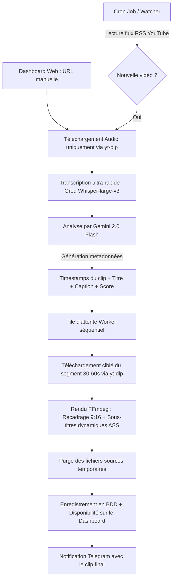

# 🎬 YouTube Shorts Viral Clipper

Système semi-automatisé d'analyse, d'extraction et de génération de **YouTube Shorts viraux** à partir de vidéos longues (podcasts, rediffusions de streams, divertissement), optimisé pour tourner sur une infrastructure légère et peu coûteuse.

---

## 📌 1. Contexte & Objectifs

* **Le concept :** Détecter les moments forts et viraux (30 à 60 secondes) dans les vidéos longues de chaînes cibles, les recadrer au format vertical (9:16), incrusté de sous-titres animés et de métadonnées percutantes (titres, tags, descriptions).
* **Le modèle de diffusion (Semi-automatisé) :** 
  * Plutôt qu'un upload direct et risqué via l'API YouTube, le pipeline prépare les clips et les met à disposition sur un **Dashboard web** et/ou les envoie via un **Bot Telegram / Webhook Discord**.
  * **Pourquoi ce choix ?**
    1. **Contournement des quotas YouTube API** : L'API limite à 6 uploads/jour (1 600 unités par upload sur un quota de 10 000/jour).
    2. **Éviter le statut "Privé" forcé** : Les applications tierces non auditées par Google voient leurs uploads bridés en statut privé.
    3. **Sécurité & Contrôle qualité** : Validation humaine pour éviter les strikes de droit d'auteur (Content ID) et la sanction pour *"Contenu réutilisé sans valeur ajoutée"*.
* **Monétisation visée :** Au-delà du faible RPM des Shorts Adsense (~0,01 $ à 0,07 $ pour 1 000 vues), le modèle vise le trafic, l'affiliation, les partenariats/sponsors et la croissance d'audience.

---

## ⚙️ 2. Contraintes d'Infrastructure & Optimisations

Le projet est calibré pour tourner sur un **VPS OVH d'entrée de gamme** :
* **Ressources :** 2 vCores, 4 Go de RAM, 40 Go de stockage NVMe/SSD.
* **Budget outils tiers :** Moins de 5 € / mois (largement sous le budget max de 20 €).

### Stratégies d'optimisation indispensables :
1. **Zéro saturation disque (40 Go)** : L'analyse se fait uniquement sur la piste audio compressée. La vidéo brute n'est jamais téléchargée en entier : seul l'extrait ciblé (30-60s) est téléchargé et traité avant suppression immédiate des rushs temporaires.
2. **Économie de RAM & CPU** :
   * Pas de JVM Java lourde (Spring) ni de multiplicité de conteneurs Docker indépendants.
   * Déportation de la transcription lourde (Whisper) et de l'analyse IA vers des API cloud ultra-rapides et très peu coûteuses.
   * File d'attente séquentielle (FIFO) : une seule conversion vidéo FFmpeg à la fois pour ne jamais écraser les 2 vCores.
3. **Surveillance des chaînes sans quota** : Utilisation des flux RSS natifs de YouTube (`https://www.youtube.com/feeds/videos.xml?channel_id=...`) plutôt que l'API officielle.

---

## 🛠️ 3. Stack Technique Retenue

| Composant | Technologie | Rôle & Justification |
| :--- | :--- | :--- |
| **Backend & Worker** | **Python (FastAPI)** | Écosystème roi pour la manipulation multimédia (`yt-dlp`, FFmpeg, API Google GenAI). Faible empreinte mémoire (~70 Mo de RAM). |
| **Frontend Dashboard** | **Vue 3 (Vite + TailwindCSS)** | Dashboard léger, moderne et réactif pour piloter les chaînes suivies, lancer des vidéos manuelles et télécharger les clips. |
| **Base de Données & Queue** | **SQLite / Peewee ou SQLAlchemy** | Simple, sans serveur, ultra-léger et largement suffisant pour orchestrer l'état des jobs et l'historique des shorts. |
| **Transcription** | **Groq API (Whisper-Large-v3)** | Transcription intégrale en ~5 secondes pour quelques fractions de centimes, avec timestamps précis mot à mot. |
| **Cerveau & Analyse Virale** | **Google Gemini 2.0 / 1.5 Flash** | Fenêtre de contexte de 1M+ tokens, traitement multimodal audio/texte, détection d'accroches (hooks), scoring de viralité et rédaction de titres/descriptions. |
| **Rendu Vidéo** | **FFmpeg** | Découpage à la frame près, recadrage 9:16 (effet split-screen ou arrière-plan flouté), génération des sous-titres animés au format ASS. |
| **Notifications** | **Bot Telegram / Webhook Discord** | Envoi instantané d'une notification avec le clip vidéo ou le lien de téléchargement direct. |

---

## 🔄 4. Le Pipeline de Traitement



---

## 📊 5. Estimation des Coûts Mensuels

| Service | Coût estimé |
| :--- | :--- |
| **VPS OVH (2 vCores, 4 Go RAM)** | Existant (~5-10 €/mois) |
| **Groq API (Whisper)** | Gratuit (Tier gratuit généreux) ou ~0.10 $ pour 50 vidéos |
| **Gemini 2.0 Flash (Google AI Studio)** | < 1 à 2 $ / mois pour des centaines d'heures de transcriptions analysées |
| **Bot Telegram / RSS** | 100 % Gratuit |
| **Total additionnel** | **< 3 € / mois** |

## 💻 Utilisation du CLI (Phase 1)

Pour tester l'extraction, la détection des clips viraux et le rendu vidéo 9:16 :

1. Renseigne ta clé API Gemini dans le fichier `.env` :
   ```bash
   GEMINI_API_KEY=AIzaSy...
   ```
2. Lance l'outil sur la vidéo YouTube de ton choix :
   ```bash
   uv run python -m src.cli --url "https://www.youtube.com/watch?v=VOTRE_VIDEO"
   ```
   *Options :*
   * `--render` : Découpe et encode directement le Short #1 en 1080x1920 avec fond flouté et sous-titres incrustés.
   * `--clip-index 0` : Choisis l'index du clip à générer si plusieurs sont détectés.

---

## 🖥️ 6. Dashboard Web (Vue 3 + FastAPI)

L'application intègre un Dashboard complet pour piloter la création et gérer le stockage :

* **Lancement en local (Dev)** :
  ```bash
  # Lancer l'API FastAPI
  uv run uvicorn src.api:app --reload --port 8000

  # Lancer le frontend Vue 3
  cd frontend && npm run dev
  ```
* **Accès Dashboard** : `http://localhost:5173` (en dev) ou `http://localhost:8000` (en production / Docker).

---

## 🌐 7. Déploiement VPS avec CloudPanel & GitHub Actions

### A. Configuration du site sur CloudPanel
1. Connecte-toi à ton interface **CloudPanel**.
2. Clique sur **+ Add Site** > **Reverse Proxy**.
3. Remplis les champs :
   * **Domain Name** : `shorts.tondomaine.com` (ou sous-domaine de ton choix chez IONOS).
   * **Reverse Proxy URL** : `http://127.0.0.1:8000`
4. Active le certificat **SSL Let's Encrypt** en 1 clic dans l'onglet *SSL/TLS*.

### B. Secrets GitHub Actions
Dans ton dépôt GitHub (`Settings` > `Secrets and variables` > `Actions` > `Repository secrets`), configure :
* `VPS_HOST` : IP de ton VPS (ex: `51.xxx.xxx.xxx`) ou ton domaine.
* `VPS_USER` : Utilisateur SSH (ex: `ubuntu` ou `debian`).
* `VPS_SSH_KEY` : Ta clé privée SSH (`id_ed25519` ou `id_rsa`).
* `VPS_PORT` : Port SSH (`22`).

À chaque `git push origin main`, GitHub Actions déploie, rebuilde le conteneur Docker et nettoie les images orphelines pour économiser le SSD.

---

## 🚀 8. Roadmap du Projet

- [x] **Phase 1 : Cœur de détection et de rendu (CLI / Scripts Python)**
  - [x] Extraction automatique des sous-titres / transcription horodatée avec découpage pour vidéos longues.
  - [x] Prompt d'ingénierie Gemini Flash (détection de hook, score de viralité, titres/tags).
  - [x] Découpage ciblé avec `yt-dlp` et encodage FFmpeg (9:16 vertical + face-tracking MediaPipe + sous-titres ASS).
- [x] **Phase 2 : Dashboard & API Web (FastAPI + Vue 3)**
  - [x] API backend FastAPI avec streaming vidéo et téléchargement avec purge immédiate.
  - [x] Dashboard Vue 3 moderne (glassmorphism, lecteur 9:16, suivi des jobs en temps réel).
- [x] **Phase 3 : Conteneurisation & CI/CD**
  - [x] Multi-stage Dockerfile & `docker-compose.yml` (liaison locale 127.0.0.1:8000 pour CloudPanel).
  - [x] Workflow GitHub Actions (`.github/workflows/deploy.yml`) d'auto-déploiement sur push `main`.
- [ ] **Phase 4 : Automatisation continue (Watcher)**
  - [ ] Surveillance périodique des flux RSS YouTube pour auto-détection 1-2 fois par jour.
  - [ ] Notifications Telegram directes avec lien de téléchargement.

